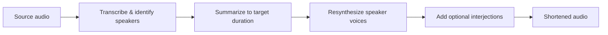

# CARD Framework

**CARD — Constraint-aware Audio Resynthesis and Distillation** turns long, multi-speaker recordings into shorter conversational audio. It summarizes toward a chosen duration and resynthesizes the dialogue using the original speakers' voices.

The project combines speech transcription with a summarizer–critic loop and voice cloning. Optional backchannels and overlapping speech add conversational detail to the final audio.

## How it works



| Stage | What it does |
| --- | --- |
| Audio preparation | Separates speech, transcribes the recording, and identifies speakers |
| Summarization | Revises speaker-tagged dialogue against content and duration checks |
| Voice synthesis | Renders summary turns with IndexTTS; can render during summary editing |
| Interjection | Adds optional backchannels and speech overlap |

Runs produce a transcript, a speaker-tagged XML summary, and audio outputs when synthesis is enabled. The repository also includes QMSum and SPoRC summarization benchmarks, source-grounded question answering, and speaker diarization evaluation.

## Install with pip

Requires Python 3.12 or newer.

```sh
pip install card-framework
card-framework doctor
```

`card-framework doctor` checks FFmpeg, uv, the GPU, the LLM, and disk space, and says how to fix anything that's missing. It doesn't download anything.

CARD uses an LLM to write the summary. By default that's a vLLM server at `http://localhost:8000/v1`; point to another one with `--llm-url`. To use a hosted model instead, set its API key and pick a profile:

```sh
export DEEPSEEK_API_KEY=...    # PowerShell: $env:DEEPSEEK_API_KEY = "..."
card-framework shorten episode.wav --to 5m --llm deepseek_chat
```

Keys can also go in a `.env` file in the folder you run from. Other profiles include `google_gemini`, `glm_46`, and `anthropic_claude_opus`. An unknown name lists them all.

While a run is going, CARD lists each stage as it finishes and writes the pipeline's full output to `card.log` in the output folder. Partway through shortening an hour-long episode, it looks like this:

```text
 ▂▅█▆▃  CARD  episode.wav → 5:00

   ✓   Setup                                                               0:41
   ✓   transcript.json               2 speakers, 58:12 of speech           6:02
   ⠋   summary.xml                   Writing a summary that fits the time  0:09
   ·   voice_cloned.wav
   ·   voice_cloned_interjected.wav

   Log: episode-5m/card.log
```

When the run ends, CARD prints the path of the shortened audio on stdout, so `card-framework shorten ... | xargs ffplay` works. `--json` prints every output path instead. `card-framework shorten --help` lists the other options. The command exits with 0 on success, 1 if the run fails, 2 for bad arguments, 3 when something is missing (see `doctor`), and 130 if you stop it.

The first run downloads several GB of models. Packaged CPU inference supports Windows and Linux on x86_64 and macOS on Apple Silicon; CUDA inference needs Windows or Linux on x86_64 with CUDA 12.6. A pip install includes speaker diarization only on Linux, so on Windows and macOS CARD treats each recording as one speaker.

### From Python

```python
from card_framework import infer

result = infer("episode.wav", "outputs/episode", 300, llm="deepseek_chat")
print(result.final_audio_path)
```

`infer()` draws the same stage list. `device` defaults to `"auto"`, which uses a CUDA GPU when PyTorch can see one. Pass `vllm_url=` to use your own server, or `verbose=True` to stream the pipeline's full output. If a prerequisite is missing, `infer()` raises `NotReadyError` before downloading anything.

## Run from a source checkout

Use Docker Compose for the full source-checkout workflow:

```sh
git clone https://github.com/Lolfaceftw/card-framework.git
cd card-framework
cp .env.example .env
```

On PowerShell, use `Copy-Item .env.example .env` for the copy step.

Set your model provider in [conf/config.yaml](conf/config.yaml) and add any required credentials to `.env`. The default LLM profile expects a running, OpenAI-compatible vLLM endpoint. Set `CARD_FRAMEWORK_VLLM_BASE_URL` in `.env` to an address reachable from the container. Container `localhost` refers to the container itself.

Place an input recording at `audio.wav`, then build and run:

```sh
docker compose build setup-and-run
docker compose run --rm setup-and-run --audio-path audio.wav
```

For an NVIDIA GPU exposed to Docker:

```sh
docker compose --profile gpu run --rm setup-and-run-gpu --override audio.device=cuda --audio-path audio.wav
```

Use `--help` for available run options. See [Configuration](CONFIG.MD) for duration settings, provider selection, and Docker runtime requirements. The first run downloads model weights and prepares the speech runtime.

For source development, install dependencies with `uv sync --dev`. Run checks with `uv run ruff check .` and `uv run pytest`.

## Project files

| Path | Contents |
| --- | --- |
| [src/card_framework/](src/card_framework/) | Audio processing, summarization, and runtime code |
| [conf/config.yaml](conf/config.yaml) | Source-checkout settings |
| [tests/](tests/) | Automated checks |
| [scripts/](scripts/) | SPoRC benchmark preparation and analysis helpers |
| [Dockerfile](Dockerfile), [compose.yml](compose.yml) | Container build and run setup |

## Research and license

Developed as an undergraduate research project at the **University of the Philippines Diliman** by the CARD Framework authors.

Distributed under the [PolyForm Noncommercial 1.0.0 license](LICENSE.md). See the license for permitted uses and required notices.
