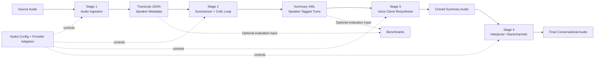

# CARD Framework

This repository is the current implementation of **CARD: Constraint-aware Audio
Resynthesis and Distillation**, the project described in
[`EEE_196_CARD_UCL.md`](./EEE_196_CARD_UCL.md).

The paper is the conceptual and academic baseline. The codebase, however, has
already moved beyond parts of the manuscript's original implementation plan.
This README therefore prioritizes **what the repository actually does now**.
When the paper and the current code diverge, treat the code, config, and
`coder_docs` as the source of truth for day-to-day development.

## Paper Metadata

**Authors**

- Rei Dennis Agustin, 2022-03027, BS Electronics Engineering
- Sean Luigi P. Caranzo, 2022-05398, BS Computer Engineering
- Johnbell R. De Leon, 2021-01437, BS Computer Engineering
- Christian Klein C. Ramos, 2022-03126, BS Electronics Engineering

**Research Adviser**

- Rowel D. Atienza

**Affiliation**

- University of the Philippines Diliman
- December 2025

## Abstract

CARD addresses the long-form podcast consumption bottleneck by generating a
shorter conversational audio output that retains speaker identity and
prosodic character instead of collapsing everything into plain text. The
project combines transcript generation, speaker-aware summarization,
voice-cloned resynthesis, and conversational overlap handling so a
multi-speaker recording can be compressed toward a user-defined duration
without discarding the listening experience that makes the original medium
valuable.

## High-Level Architecture



## What CARD Does

CARD is a multi-stage pipeline for converting long-form multi-speaker audio into
a shorter, speaker-aware, resynthesized conversational output.

At a high level, the repository currently supports:

- **Stage 1: Audio ingestion and transcript generation**
  - Source separation
  - Granite Speech ASR by default, plus diarization and alignment
  - Transcript JSON generation with speaker metadata
- **Stage 2: Constraint-aware summarization**
  - Summarizer and critic agent loop
  - Duration-first summary generation with speaker-tagged XML output
  - Retrieval-backed or full-transcript summarization paths
- **Stage 3: Voice cloning and resynthesis**
  - Speaker sample generation
  - Voice-cloned rendering of summary turns
  - Live-draft voice cloning during summarizer edits
- **Stage 4: Conversational interjection**
  - Optional overlap and backchannel synthesis on top of the cloned summary
- **Benchmarking and evaluation**
  - Summarization benchmark workflows
  - Source-grounded QA benchmark workflows
  - Diarization benchmark workflows

## Paper vs. Current Repository

[`EEE_196_CARD_UCL.md`](./EEE_196_CARD_UCL.md) explains the original CARD paper,
problem framing, and proposed module design. The repository now reflects a more
developed engineering system than that initial write-up.

Important differences from the manuscript-level description include:

- The repo is now **configuration-driven** through Hydra instead of being tied
  to one fixed experimental path.
- The runtime is now **duration-first**, centered on `target_seconds` and
  tolerance checks, rather than a simple word-budget-only workflow.
- The summary output contract is now **speaker-tagged XML**, which feeds the
  downstream voice-clone and interjector stages.
- The default stage-2/stage-3 flow can use **live-draft voice cloning**, where
  turn audio is rendered during summary editing instead of only after the final
  draft is approved.
- The repository includes substantial **benchmarking, evaluation, and operator
  tooling** that goes beyond the initial paper narrative.
- Provider support has expanded: the codebase is organized around adapters and
  config-selected backends rather than a single hardcoded model stack.

In short: the paper explains **why CARD exists**; this repository captures
**how CARD currently works**.

## Repository Layout

```text
src/card_framework/
  agents/           A2A executors, DTOs, tool loops, client transport
  audio_pipeline/   Audio ingestion, speaker samples, voice cloning, interjector
  benchmark/        Summarization, QA, and diarization benchmarks
  cli/              Runtime, setup, calibration, matrix, and eval entrypoints
  config/           Bundled fallback config for packaged installs
  orchestration/    Transcript DTOs and stage orchestration
  prompts/          Jinja2 prompt templates
  providers/        LLM and embedding provider adapters
  retrieval/        Transcript indexing and retrieval
  runtime/          Runtime planning and execution support
  shared/           Shared utilities, events, and logging
  _vendor/index_tts/
```

Other important locations:

- `artifacts/`: generated transcripts, cloned audio, benchmark outputs, and
  other runtime artifacts
- `checkpoints/`: local model/runtime checkpoints
- `conf/config.yaml`: canonical human-edited runtime config for source checkouts
- `src/card_framework/config/config.yaml`: packaged fallback config bundled into
  the installed distribution
- `.env.example`: template for provider secrets and optional local overrides
- `coder_docs/`: repository-specific architecture, workflow, and maintenance
  guidance

## Common Commands

```bash
uv sync --dev
uv run python -m card_framework.cli.main --help
uv run python -m card_framework.cli.setup_and_run --help
uv run python -m card_framework.cli.calibrate --help
uv run python -m card_framework.cli.run_summary_matrix --help
uv run python -m card_framework.benchmark.run --help
uv run python -m card_framework.benchmark.watchdog --help
uv run python -m card_framework.benchmark.summarizer_critic --help
uv run python -m card_framework.benchmark.summarizer_critic.sporc --help
uv run python -m card_framework.benchmark.diarization --help
uv run python -m card_framework.benchmark.qa --help
uv run python -m card_framework.benchmark.qa_supervisor --help
uv run ruff check .
uv run pytest
```

Common execution entrypoints:

```bash
uv run python -m card_framework.cli.setup_and_run --audio-path <path-to-audio>
uv run python -m card_framework.cli.main
uv run python -m card_framework.cli.calibrate
```

These runtime entrypoints now emit timed `Loading ...` and
`Loaded ... in X.XX seconds.` status lines around slow startup and bootstrap
phases such as packaged runtime setup, transcript loading, calibration,
provider setup, retrieval indexing, and A2A readiness so cold starts no longer
look idle. Stage-1 transcription now uses the same timed loading pattern for
the default Granite Speech model load and publishes inline progress such as
`segment 3/12` plus an ETA from the configured/default stage throughput on the
first run, then refines later runs with learned history. Stage-1 separation now
also emits timed Demucs loading/status lines and the same first-run ETA
behavior, while long source files are separated in bounded outer windows so RAM
does not scale with the full recording length.

## Configuration

The repository now uses a small selector-based config instead of a long
comment-and-uncomment provider block.

- Edit `conf/config.yaml` for normal source-checkout work.
- Keep real secrets in `.env`, not in tracked YAML files.
- Copy `.env.example` to `.env` and fill only the provider keys you actually
  use.
- Long stage-1 separations now default to `audio.separation.window_length_seconds=600`
  with `audio.separation.window_context_seconds=5` so Demucs works on bounded
  outer windows before stitching the vocals stem back together.
- Stage-1 ASR now defaults to `audio.asr.provider=granite_speech` with
  `ibm-granite/granite-4.0-1b-speech`, `30s` chunks, `5s` overlap, and
  forced alignment enabled. `faster_whisper` remains available as an explicit
  opt-in provider.
- For the full workflow, profile names, and common examples, see
  [`CONFIG.MD`](./CONFIG.MD).

Benchmark helpers:

```bash
uv run python -m card_framework.benchmark.summarizer_critic prepare-dataset
uv run python -m card_framework.benchmark.summarizer_critic execute --prepare-if-missing --summarizer-provider vllm_default
uv run python -m card_framework.benchmark.summarizer_critic supervise --prepare-if-missing --max-runs 3
uv run python -m card_framework.benchmark.summarizer_critic.sporc prepare-dataset --dataset-variant sample
uv run python -m card_framework.benchmark.summarizer_critic.sporc prepare-dataset --dataset-variant full
uv run python -m card_framework.benchmark.summarizer_critic.sporc curate-longform
uv run python -m card_framework.benchmark.summarizer_critic.sporc dedupe-manifest
uv run python -m card_framework.benchmark.summarizer_critic.sporc export-transcripts --episodes 7-10
uv run python -m card_framework.benchmark.summarizer_critic.sporc human-sample --duration-preset 5m --episodes 20
uv run python -m card_framework.benchmark.summarizer_critic.sporc llm-sample --duration-preset 5m --episodes 20
uv run python -m card_framework.benchmark.summarizer_critic.sporc execute --prepare-if-missing --max-samples 100 --summarizer-provider vllm_default
uv run python -m card_framework.benchmark.summarizer_critic.sporc duration-sweep --mode batch-all --max-samples 10 --summarizer-provider vllm_default
uv run python -m card_framework.benchmark.summarizer_critic.sporc supervise --prepare-if-missing --max-runs 3
```

The new `summarizer_critic` benchmark package uses the official QMSum repository
as its real public dataset source, prepares the full `data/ALL/test`
general-meeting-summary slice, derives each `target_seconds` value from the
human reference summary length, runs the actual summarizer and critic agents,
and writes JSON plus markdown artifacts under
`artifacts/summarizer_critic_benchmark`.

The SPoRC path lives at `card_framework.benchmark.summarizer_critic.sporc`.
It prepares SPoRC episode and speaker-turn files, feeds transcript samples into
the existing summarizer-critic loop, defaults to 100 examples per run, treats
`--max-samples 0` as all prepared examples, and uses LLM-as-a-judge scoring for
`Factualness`, `Naturalness`, and `Speaker Grammar Similarity`. Because the
upstream `blitt/SPoRC` dataset is gated on Hugging Face, prepare runs need
accepted data terms plus an authenticated `HF_TOKEN` or explicit local SPoRC
file paths. The execute path still supports the repo's faithful combined
stage-2/stage-3 voice-clone integration, but it now also supports
`--transcript-only` for transcript-first summarizer-critic benchmarking that
skips source-audio downloads, speaker-sample generation, and live-draft voice
cloning. Transcript-only runs now also normalize the copied working transcript:
they drop punctuation-only micro-segments, merge adjacent same-speaker spans,
preserve raw dataset speaker lists in segment extras for auditability, and mark
ambiguous turns with speaker-candidate metadata instead of forcing those turns
onto a neighboring speaker so the working transcript stays faithful to the
dataset-derived attribution. Sample preparation still defaults to
`artifacts/summarizer_critic_benchmark/datasets/sporc/prepared_sample`, while
full-dataset preparation now defaults to
`artifacts/summarizer_critic_benchmark/datasets/sporc/prepared_full` and writes
a compact `manifest.json` plus a streaming `samples.jsonl.gz` sidecar so the
full prepare path and downstream readers do not materialize the entire SPoRC
table in RAM at once. SPoRC `execute` and `duration-sweep` now treat
`--max-samples` as a retained-sample target instead of a raw prefix length:
infra-only exclusions such as preflight incompatibility, connection/startup
unavailability, stage timeouts, or resumed stalled samples do not consume the
target, so the runner will backfill with the next deterministic candidate and
can inspect candidate `101` to retain `100` benchmarked samples. The SPoRC CLI
also now prints timed stderr loading lines
during long prepare phases so full prepares no longer appear blank after the
Hugging Face download progress bars finish. The `curate-longform` subcommand
now emits the same timed status lines while it loads the source manifest,
evaluates stored curation stats, and writes the curated manifest plus audit
JSON. Fresh `prepare-dataset` outputs now persist reusable long-form curation
stats in each prepared sample, so `curate-longform` no longer needs to reopen
every transcript JSON unless it is filtering an older manifest that predates
those stats. It filters a prepared full manifest down to strict long-form
multi-speaker episodes using the released Hugging Face speaker-turn table as
the diarized transcript source, requiring `15,000+` spoken words, multiple
substantial speakers, strong turn counts, and low music/noise-token ratios.
The new `dedupe-manifest` subcommand rewrites an inline SPoRC manifest in
place, removing exact duplicate episodes with a metadata-first pipeline that
only opens transcript JSON for small candidate-collision groups instead of
hashing every transcript up front. It emits a sibling audit JSON describing the
removed duplicates while preserving manifest order for the kept samples.
The new `export-transcripts` subcommand reads a manifest plus an episode list or
range and writes one combined raw transcript `.txt` file from the manifest's
actual SPoRC `turn_data_path`, not from the prepared transcript JSON. It
touches only the selected episode rows plus one streamed pass over the raw turn
file, so export stays fast even when the full SPoRC manifest is large.
The new `human-sample` subcommand turns that curated manifest into a Rich-based
human annotation workflow: it takes the first `N` episodes in manifest order,
computes a per-episode sampled-word budget from configurable `WPM` and factor
defaults, splits each transcript into word-balanced windows, accepts transcript
line numbers or `/override` text per window, writes live JSONL/CSV exports plus
a SQLite session database under
`artifacts/summarizer_critic_benchmark/sporc_human_sampling`, and resumes a
paused session by UUID after `Ctrl+C`.
The new `llm-sample` subcommand runs an Anthropic-backed automatic sampler over
that same curated manifest prefix: it keeps the same per-episode word-budget
formula, sends the whole transcript in one pass, streams summarized thinking
plus the structured sample payload through the Rich callback path, and persists
run-level JSONL, CSV, and per-episode request/stream/response traces under
`artifacts/summarizer_critic_benchmark/sporc_llm_sampling`. It currently reads
`ANTHROPIC_API_KEY` from `.env` and defaults to `claude-opus-4-6` with adaptive
thinking enabled. If you pass `--samples <N>`, it skips the WPM-based budget
and returns exactly `N` samples per transcript instead. Each saved sample now
includes a direct `speaker_label`, and each episode also writes a plain-text
`selected_segments.txt` export. The structured tool payload is the authoritative
selection output. The prompt now explicitly favors readable reviewer-facing
segments: it asks the model to preserve what the speaker said, including
disfluencies, while lightly cleaning up only transcript formatting noise such
as fragmentation, spacing, and punctuation so the result stays understandable
to a human reviewer. It no longer rejects runs just because Anthropic chooses
to skip or include extra prose around that tool call. If you pass
`--disable-thinking`, it disables Anthropic thinking and sends `temperature=0.0`.
If you pass `--select-episode "[7,10]"`, `llm-sample` runs only manifest
episodes `7` through `10` inclusive instead of the default manifest prefix.
The new `duration-sweep` subcommand exposes a non-interactive menu plus
`--mode single` and `--mode batch-all` flows for preset duration benchmarking
across `30s`, `1m`, `5m`, and `15m`, writes aggregate markdown and JSON sweep
artifacts under `artifacts/summarizer_critic_benchmark/sweeps`, and keeps the
default benchmark vLLM profile compatible with `VLLM_URL` overrides.

## Package Usage

The repository now exposes a library entrypoint for installed-package use:

```bash
pip install card-framework
```

```python
from card_framework import infer

result = infer(
    "audio.wav",
    "outputs/run_001",
    300,
    device="cpu",
    vllm_url="http://localhost:8000/v1",
)
print(result.summary_xml_path)
print(result.final_audio_path)
```

`infer(audio_wav, output_dir, target_duration_seconds, *, device, ...)` runs
the full stage-1 to stage-4 pipeline and returns an `InferenceResult` with the
main emitted artifact paths. `target_duration_seconds` is required for every
call and overrides any duration target declared in the loaded config file.
`device` is also required and must be either `cpu` or `cuda`. `vllm_url` is the
first-class packaged-runtime override for OpenAI-compatible endpoints, and it
forces the shared summarizer, critic, and interjector LLM path onto the
provided vLLM-compatible server for that call. The call writes into `output_dir`
using this high-level layout:

```text
outputs/run_001/
  transcript.json
  summary.xml
  agent_interactions.log
  audio_stage/
    voice_clone/
    interjector/
```

Packaged `infer(...)` now delegates through `card_framework.cli.setup_and_run`
so live operator output streams again during pip-installed runs. Relative input
discovery in that wrapper follows the caller workspace, while the packaged
`infer(...)` contract still keeps final run artifacts under the explicit
`output_dir`. The packaged entrypoint and wrapper now also emit timed stderr
loading lines during runtime-config preparation, packaged IndexTTS bootstrap,
and later runtime startup phases.

Installed-package runtime notes:

- Supported packaged `infer(...)` CPU platforms as of March 15, 2026:
  Windows x86_64, Linux x86_64, and macOS arm64. macOS Intel is out of scope
  for the public whole-pipeline contract.
- `CARD_FRAMEWORK_CONFIG`: optional path to a full YAML config file when you
  need to override the default packaged provider/runtime config for `infer(...)`.
- `CARD_FRAMEWORK_HOME`: optional writable runtime home used for extracted
  IndexTTS assets, checkpoints, and bootstrap state. If unset, the package uses
  the platform-appropriate user data directory.
- `CARD_FRAMEWORK_VLLM_URL`: optional environment-variable equivalent of the
  `vllm_url=` argument.
- `CARD_FRAMEWORK_VLLM_API_KEY`: optional environment-variable equivalent of
  the `vllm_api_key=` argument. If omitted for vLLM, the packaged runtime uses
  `EMPTY`, which matches the common local keyless vLLM setup.
- If you choose `device="cuda"`, the packaged runtime supports only Windows
  x86_64 and Linux x86_64, and it still requires CUDA 12.6. macOS remains
  CPU-only for the packaged runtime. `infer(...)` inspects the installed
  PyTorch build first and, when the host itself reports CUDA 12.6,
  automatically replaces CPU-only or mismatched `torch` and `torchaudio`
  wheels with the CUDA 12.6 build before it proceeds. In a uv-managed project
  it uses `uv pip`; otherwise it falls back to `python -m pip`.
- The packaged default is now vLLM-first. If the effective config selects
  another provider, `infer(...)` resolves required credentials before it starts
  the subprocess runtime:
  - interactive terminals: `infer(...)` securely prompts for missing API keys
    or access tokens without echoing them and without placing them on the
    subprocess command line
  - non-interactive runs: `infer(...)` fails fast with an actionable error that
    names the missing config field and the supported environment variable
- Supported credential environment variables for the packaged path include
  `DEEPSEEK_API_KEY`, `GEMINI_API_KEY` or `GOOGLE_API_KEY`, `ZAI_API_KEY`,
  `HUGGINGFACE_TOKEN` or `HF_TOKEN`, and the configured
  `audio.diarization.pyannote.auth_token_env` value.
- If the effective config selects a NeMo-derived diarization backend on an
  unsupported platform or when `nemo-toolkit[asr]` is not installed,
  `infer(...)` now warns and falls back to
  `audio.diarization.provider=single_speaker` instead of hard-failing during
  bootstrap.
- `CARD_FRAMEWORK_FFMPEG_EXECUTABLE`: optional path to a custom `ffmpeg`
  binary. When unset, packaged `infer(...)` falls back to the bundled
  `imageio-ffmpeg` executable and prepends its directory to `PATH` for nested
  subprocesses.
- `CARD_FRAMEWORK_UV_EXECUTABLE`: optional path to a custom `uv` binary.
  When unset, packaged `infer(...)` resolves the installed `uv` console script
  from the active environment before bootstrapping the vendored IndexTTS
  runtime.
- Packaged `infer(...)` no longer publishes `ctc-forced-aligner` in
  `Requires-Dist`. It first tries to install the pinned upstream source on
  demand when stage-1 forced alignment needs it. If that bootstrap cannot
  complete, packaged inference falls back to approximate segment-derived timing
  instead of failing the whole run.
- `.github/workflows/ci.yml` now enforces targeted package-import, CLI-smoke,
  supervisor, and runtime-layout coverage across `windows-2025`,
  `ubuntu-24.04`, and `macos-14` so the supported CPU platform set stays
  validated in CI.

## Public PyPI Release

This repository now includes a GitHub Actions trusted-publishing workflow at
`.github/workflows/publish-pypi.yml` that publishes tags matching `v*` to PyPI.

The public PyPI project already exists. As of March 9, 2026:

- `1.0.1` is the first public release, but it published the wrong bare
  `ctc-forced-aligner` dependency name for downstream `pip` users.
- `v1.0.2` was tagged but never published because PyPI rejected the direct Git
  dependency metadata.
- `1.0.4` is the current public release.
- The next install-path fix must ship under a new version such as `1.0.5`; do
  not reuse a failed or already-published version number.

Repository-side release steps:

1. Create a dedicated release-preparation branch such as `release/v1.0.5` from
   the target integration branch, then run the release preflight in
   [`coder_docs/github_actions_release_spec.md`](./coder_docs/github_actions_release_spec.md),
   including build, targeted tests, and artifact-scoped `uv publish --dry-run`.
2. Merge the reviewed release branch, then tag the merged integration-branch
   commit and push it, for example:

   ```bash
   git tag -a v1.0.5 -m v1.0.5
   git push origin v1.0.5
   ```

3. Do not assume the release is complete just because the tag push succeeded.
   Watch the GitHub Actions run to completion and inspect failures directly if
   needed:

   ```bash
   gh run list --workflow "Publish PyPI Package" --limit 1
   gh run watch <run-id> --exit-status
   gh run view <run-id> --log-failed
   ```

4. After the workflow succeeds, verify the public release:

   ```bash
   python -m pip install --no-cache-dir card-framework
   python -c "from card_framework import infer; print(infer)"
   ```

For the repo-specific release build standards and post-tag verification rules,
see [`coder_docs/github_actions_release_spec.md`](./coder_docs/github_actions_release_spec.md).

## Documentation

- [`EEE_196_CARD_UCL.md`](./EEE_196_CARD_UCL.md): the CARD paper and project
  manuscript
- [`CONFIG.MD`](./CONFIG.MD): runtime config, `.env`, provider profiles, and
  common configuration examples
- [`coder_docs/codebase_guide.md`](./coder_docs/codebase_guide.md): current
  architecture, runtime flow, commands, and maintenance expectations
- [`coder_docs/research_agents.md`](./coder_docs/research_agents.md):
  authoritative Codex delegation and delegated web-research workflow
- [`coder_docs/memory/errors_and_notes.md`](./coder_docs/memory/errors_and_notes.md):
  repository memory for recurring pitfalls and prior fixes
- [`coder_docs/fault_localization_workflow.md`](./coder_docs/fault_localization_workflow.md):
  bug triage and failing-test workflow

If you are changing behavior, prompts, workflows, or commands, start with
`coder_docs/codebase_guide.md`.

If you are working through Codex, follow `AGENTS.md` plus
`coder_docs/research_agents.md` so delegation stays aligned with the configured
sub-agents in `../.codex/config.toml` and any delegated open-web work still
follows the repo Scrapling workflow.

## License

This repository is source-available under
[`LICENSE.md`](./LICENSE.md), using the **PolyForm Noncommercial 1.0.0**
license. Noncommercial use is allowed; commercial use requires separate
permission from the licensors.
