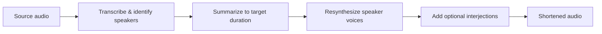

# CARD Framework

**CARD — Constraint-aware Audio Resynthesis and Distillation** turns long, multi-speaker recordings into shorter conversational audio. It summarizes toward a chosen duration and resynthesizes the dialogue using the original speakers' voices.

The project combines speech transcription with a summarizer–critic loop and voice cloning. Optional backchannels and overlapping speech add conversational detail to the final audio.

## How it works



| Stage | What it does |
| --- | --- |
| Audio preparation | Separates speech, transcribes the recording, and identifies speakers |
| Summarization | Revises speaker-tagged dialogue against content and duration checks |
| Voice synthesis | Renders summary turns with IndexTTS; can render during summary editing |
| Interjection | Adds optional backchannels and speech overlap |

Runs produce a transcript, a speaker-tagged XML summary, and audio outputs when synthesis is enabled. The repository also includes QMSum and SPoRC summarization benchmarks, source-grounded question answering, and speaker diarization evaluation.

## Quick start

Use Docker Compose for the full source-checkout workflow:

```sh
git clone https://github.com/Lolfaceftw/card-framework.git
cd card-framework
cp .env.example .env
```

On PowerShell, use `Copy-Item .env.example .env` for the copy step.

Set your model provider in [conf/config.yaml](conf/config.yaml) and add any required credentials to `.env`. The default LLM profile expects a running, OpenAI-compatible vLLM endpoint. Set `CARD_FRAMEWORK_VLLM_BASE_URL` in `.env` to an address reachable from the container. Container `localhost` refers to the container itself.

Place an input recording at `audio.wav`, then build and run:

```sh
docker compose build setup-and-run
docker compose run --rm setup-and-run --audio-path audio.wav
```

For an NVIDIA GPU exposed to Docker:

```sh
docker compose --profile gpu run --rm setup-and-run-gpu --override audio.device=cuda --audio-path audio.wav
```

Use `--help` for available run options. See [Configuration](CONFIG.MD) for duration settings and provider selection, or the [Docker guide](coder_docs/docker_workflow.md) for runtime requirements. The first run downloads model weights and prepares the speech runtime.

## Python usage

Requires **Python 3.12 or newer**:

```sh
pip install card-framework
```

```python
from card_framework import infer

result = infer(
    "audio.wav",
    "outputs/example",
    target_duration_seconds=300,
    device="cpu",
    vllm_url="http://localhost:8000/v1",
)
print(result.summary_xml_path)
print(result.final_audio_path)
```

The example requires a running vLLM-compatible server at the supplied address. Packaged CPU inference supports Windows/Linux x86_64 and macOS Apple Silicon. Packaged CUDA inference requires Windows/Linux x86_64 with CUDA 12.6.

For source development, install dependencies with `uv sync --dev`. Run checks with `uv run ruff check .` and `uv run pytest`.

## Project files

| Path | Contents |
| --- | --- |
| [src/card_framework/](src/card_framework/) | Audio processing, summarization, and runtime code |
| [conf/config.yaml](conf/config.yaml) | Source-checkout settings |
| [tests/](tests/) | Automated checks |
| [research_doc/](research_doc/) | Technical research document |
| [EEE_196_CARD_UCL.md](EEE_196_CARD_UCL.md) | Original project manuscript |

## Research and license

Developed at the **University of the Philippines Diliman** by Rei Dennis Agustin, Sean Luigi P. Caranzo, Johnbell R. De Leon, and Christian Klein C. Ramos, advised by **Rowel D. Atienza**.

Distributed under the [PolyForm Noncommercial 1.0.0 license](LICENSE.md). See the license for permitted uses and required notices.
