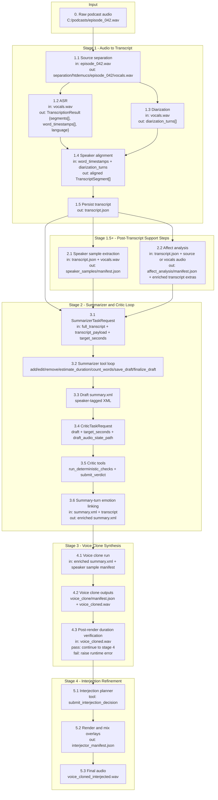
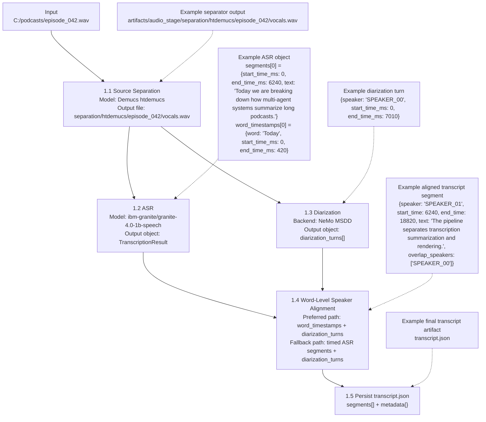
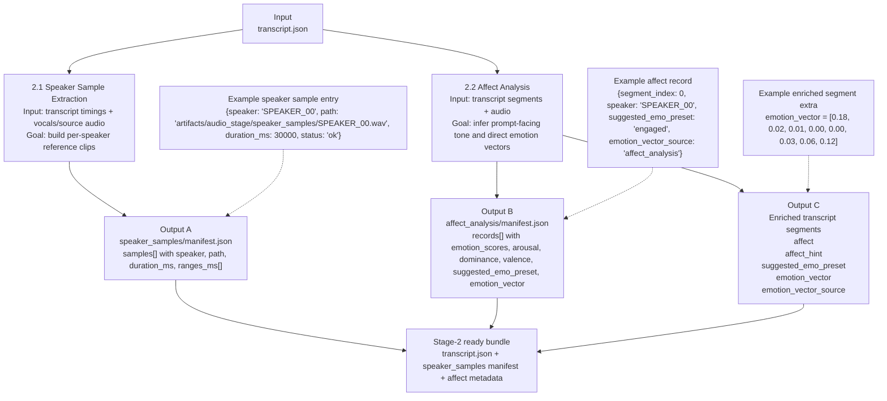
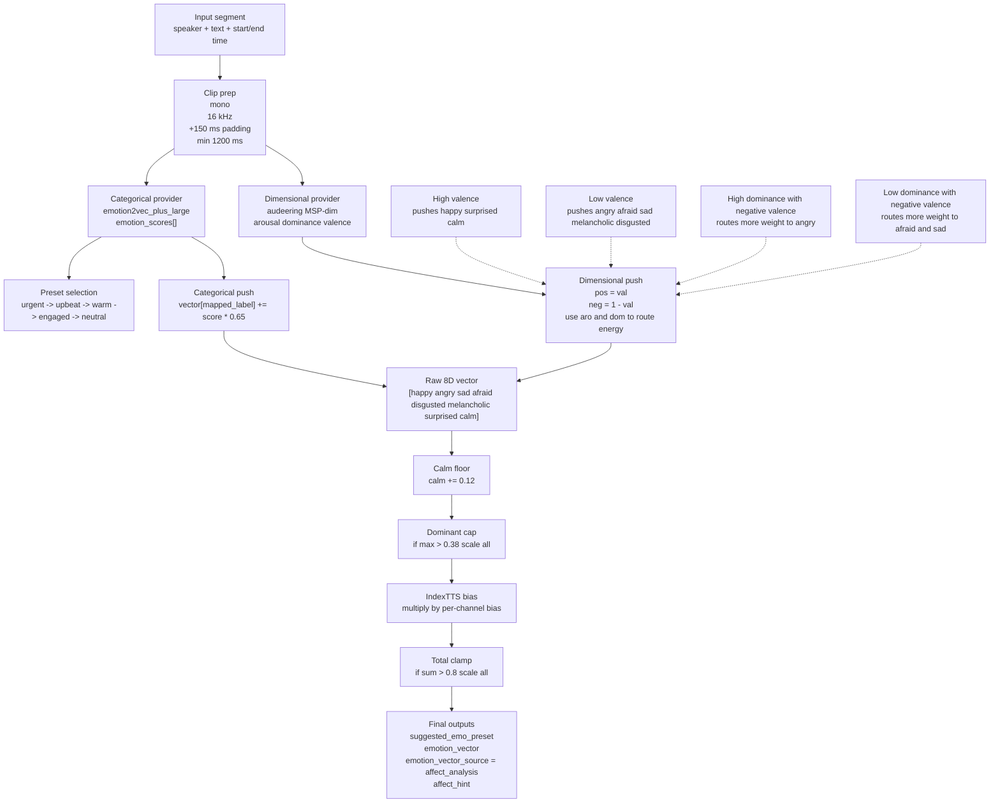
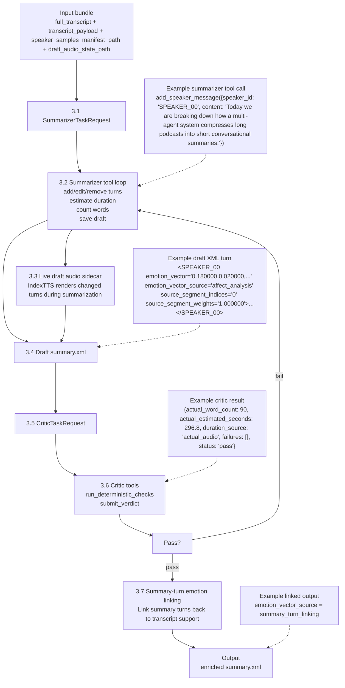
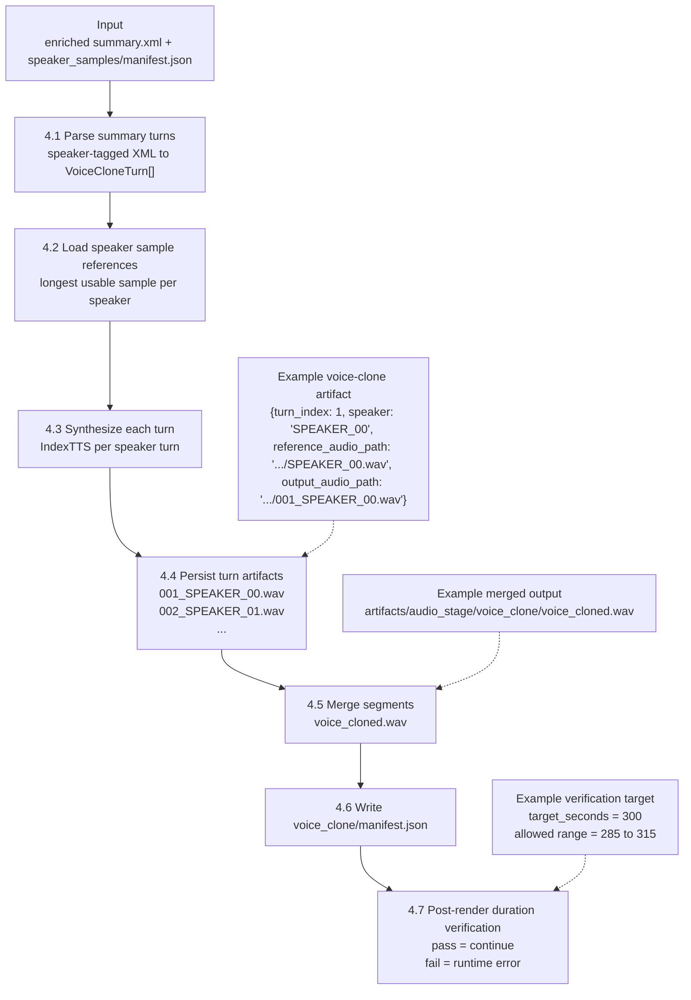
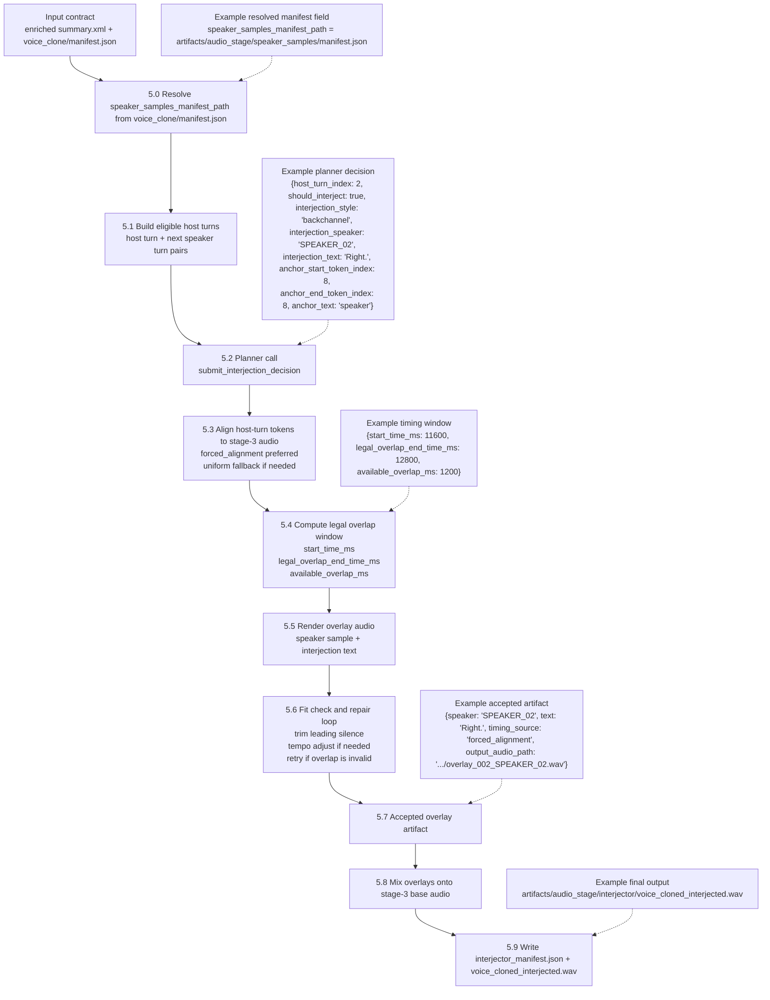

# CARD Pipeline Visualization Script

This file is meant to be edited directly while designing a figure in Canva.

The ordering below matches the default code path in this repository.

Important scope note:
- Keys, field names, and nesting below match the repository contracts.
- Example values are synthetic and truncated for readability.
- Some stage outputs are in-memory Python objects, not persisted files. Those are marked as `in-memory`.

## Default Runtime Snapshot

- Shared LLM for summarizer, critic, and interjector: `deepseek-reasoner`
- Retrieval: `OFF` by default because embeddings are disabled
- Source separation: `Demucs` model `htdemucs`
- ASR: `IBM Granite Speech` model `ibm-granite/granite-4.0-1b-speech`
- Diarization: `NeMo MSDD`
- Affect analysis:
  - `emotion2vec_plus_large`
  - `audeering/wav2vec2-large-robust-12-ft-emotion-msp-dim`
- Voice cloning: `IndexTTS`
- Stage-4 echo pacing timing backend: `faster_whisper_native` model `tiny.en`
- Duration target: `300` seconds
- Duration tolerance: `0.05`
- Accepted duration window: `285` to `315` seconds

## Example Episode

- Input audio: `C:/podcasts/episode_042.wav`
- Episode type: `62-minute tech podcast`
- Speakers:
  - `SPEAKER_00` = host
  - `SPEAKER_01` = guest A
  - `SPEAKER_02` = guest B
- Goal: `5-minute` conversational summary audio

## Mermaid: Chronological, No Skipped Steps



## Mermaid: Same Flow With One Concrete Example

```mermaid
flowchart TD
    subgraph EX0["Input"]
        EA0["0. Raw podcast audio<br/>Example input:<br/>C:/podcasts/episode_042.wav<br/>62-minute tech podcast<br/>Speakers: SPEAKER_00 host, SPEAKER_01 guest A, SPEAKER_02 guest B"]
    end

    subgraph EX1["Stage 1 - Audio to Transcript"]
        EA1["1.1 Source separation<br/>Example input:<br/>episode_042.wav<br/>Example output:<br/>artifacts/audio_stage/separation/htdemucs/episode_042/vocals.wav"]
        EA2["1.2 ASR<br/>Example input:<br/>vocals.wav<br/>Example output:<br/>TranscriptionResult<br/>segments[0] = {start_time_ms: 0, end_time_ms: 6240, text: 'Today we are breaking down how multi-agent systems summarize long podcasts.'}<br/>word_timestamps[0] = {word: 'Today', start_time_ms: 0, end_time_ms: 420}<br/>language = en"]
        EA3["1.3 Diarization<br/>Example input:<br/>vocals.wav<br/>Example output:<br/>diarization_turns[0] = {speaker: 'SPEAKER_00', start_time_ms: 0, end_time_ms: 7010}<br/>diarization_turns[1] = {speaker: 'SPEAKER_01', start_time_ms: 6240, end_time_ms: 18820}"]
        EA4["1.4 Speaker alignment<br/>Example input:<br/>word_timestamps + diarization_turns<br/>Example output:<br/>aligned segment = {speaker: 'SPEAKER_01', start_time: 6240, end_time: 18820, text: 'The pipeline separates transcription summarization and rendering.', overlap_speakers: ['SPEAKER_00']}"]
        EA5["1.5 Persist transcript<br/>Example output:<br/>transcript.json<br/>segments[0] = {speaker: 'SPEAKER_00', start_time: 0, end_time: 6240, text: 'Today we are breaking down how multi-agent systems summarize long podcasts.'}<br/>metadata.alignment_backend = ctc_forced_aligner"]
    end

    subgraph EX2["Stage 1.5+ - Post-Transcript Support Steps"]
        EB1["2.1 Speaker sample extraction<br/>Example input:<br/>transcript.json + vocals.wav<br/>Example output:<br/>speaker_samples/manifest.json<br/>samples[0] = {speaker: 'SPEAKER_00', path: 'artifacts/audio_stage/speaker_samples/SPEAKER_00.wav', duration_ms: 30000, status: 'ok'}"]
        EB2["2.2 Affect analysis<br/>Example input:<br/>transcript.json + source/vocals audio<br/>Example output:<br/>affect_analysis/manifest.json<br/>records[0] = {segment_index: 0, speaker: 'SPEAKER_00', suggested_emo_preset: 'engaged', emotion_vector: [0.18, 0.02, 0.01, 0.00, 0.00, 0.03, 0.06, 0.12], emotion_vector_source: 'affect_analysis'}<br/>enriched transcript segment carries affect_hint + emotion_vector"]
    end

    subgraph EX3["Stage 2 - Summarizer and Critic Loop"]
        EC1["3.1 SummarizerTaskRequest<br/>Example input:<br/>target_seconds = 300<br/>duration_tolerance_ratio = 0.05<br/>full_transcript = '[SPEAKER_00]: Today we are breaking down how multi-agent systems summarize long podcasts. ...'<br/>speaker_samples_manifest_path = artifacts/audio_stage/speaker_samples/manifest.json"]
        EC2["3.2 Summarizer tool loop<br/>Example tool call:<br/>add_speaker_message({speaker_id: 'SPEAKER_00', content: 'Today we are breaking down how a multi-agent system compresses long podcasts into short conversational summaries.'})<br/>Example tool result:<br/>line = 1, word_count = 15, budget.total_estimated_seconds = 18.6"]
        EC3["3.3 Draft summary.xml<br/>Example output:<br/>&lt;SPEAKER_00 emotion_vector='0.180000,0.020000,0.010000,0.000000,0.000000,0.030000,0.060000,0.120000' emotion_vector_source='affect_analysis' source_segment_indices='0' source_segment_weights='1.000000'&gt;Today we are breaking down how a multi-agent system compresses long podcasts into short conversational summaries.&lt;/SPEAKER_00&gt;"]
        EC4["3.4 CriticTaskRequest<br/>Example input:<br/>draft = summary.xml<br/>target_seconds = 300<br/>draft_audio_state_path = artifacts/audio_stage/voice_clone/live_draft_a1b2c3d4e5f6_300s.state.json"]
        EC5["3.5 Critic tools<br/>Example output:<br/>run_deterministic_checks -> {actual_word_count: 90, actual_estimated_seconds: 296.8, duration_source: 'actual_audio', failures: [], status: 'pass'}<br/>submit_verdict -> {status: 'pass', word_count: 90, estimated_seconds: 296.8}"]
        EC6["3.6 Summary-turn emotion linking<br/>Example output:<br/>enriched summary.xml<br/>emotion_vector_source becomes summary_turn_linking<br/>source_segment_indices = '0'"]
    end

    subgraph EX4["Stage 3 - Voice Clone Synthesis"]
        ED1["4.1 Voice clone run<br/>Example input:<br/>enriched summary.xml + speaker_samples/manifest.json"]
        ED2["4.2 Voice clone outputs<br/>Example output:<br/>voice_clone/manifest.json<br/>artifacts[0] = {turn_index: 1, speaker: 'SPEAKER_00', reference_audio_path: 'artifacts/audio_stage/speaker_samples/SPEAKER_00.wav', output_audio_path: 'artifacts/audio_stage/voice_clone/001_SPEAKER_00.wav'}<br/>merged_output_audio_path = artifacts/audio_stage/voice_clone/voice_cloned.wav"]
        ED3["4.3 Post-render duration verification<br/>Example input:<br/>voice_cloned.wav<br/>Example result:<br/>measured_seconds = 296.8<br/>allowed range = 285 to 315<br/>status = pass"]
    end

    subgraph EX5["Stage 4 - Interjection Refinement"]
        EE1["5.1 Interjection planner<br/>Example output:<br/>submit_interjection_decision -> {host_turn_index: 2, should_interject: true, interjection_style: 'backchannel', interjection_speaker: 'SPEAKER_02', interjection_text: 'Right.', anchor_start_token_index: 8, anchor_end_token_index: 8, anchor_text: 'speaker'}"]
        EE2["5.2 Render and mix overlays<br/>Example output:<br/>interjector_manifest.json<br/>artifacts[0] = {speaker: 'SPEAKER_02', text: 'Right.', start_time_ms: 11600, end_time_ms: 12420, duration_ms: 820, timing_source: 'forced_alignment', output_audio_path: 'artifacts/audio_stage/interjector/overlay_002_SPEAKER_02.wav'}"]
        EE3["5.3 Final audio<br/>Example output:<br/>artifacts/audio_stage/interjector/voice_cloned_interjected.wav<br/>5-minute conversational summary audio"]
    end

    EA0 --> EA1
    EA1 --> EA2
    EA1 --> EA3
    EA2 --> EA4
    EA3 --> EA4
    EA4 --> EA5
    EA5 --> EB1
    EA5 --> EB2
    EA5 --> EC1
    EB1 --> EC1
    EB2 --> EC1
    EC1 --> EC2 --> EC3 --> EC4 --> EC5 --> EC6
    EC6 --> ED1 --> ED2 --> ED3
    ED3 --> EE1 --> EE2 --> EE3
```



## Box-by-Box I/O

### Box 0. Raw Podcast Audio

Type: persisted file

Input

```text
C:/podcasts/episode_042.wav
```

Output to next box

```text
C:/podcasts/episode_042.wav
```

### Box 1.1. Source Separation

Type: persisted file

Input

```text
C:/podcasts/episode_042.wav
```

Operation

```text
Demucs htdemucs
```

Output

```text
artifacts/audio_stage/separation/htdemucs/episode_042/vocals.wav
```

### Box 1.2. ASR

Type: in-memory object

Input

```text
artifacts/audio_stage/separation/htdemucs/episode_042/vocals.wav
```

Operation

```text
IBM Granite Speech
model = ibm-granite/granite-4.0-1b-speech
```

Output

```json
{
  "segments": [
    {
      "start_time_ms": 0,
      "end_time_ms": 6240,
      "text": "Today we are breaking down how multi-agent systems summarize long podcasts."
    },
    {
      "start_time_ms": 6240,
      "end_time_ms": 18820,
      "text": "The pipeline separates transcription summarization and rendering."
    }
  ],
  "word_timestamps": [
    {"word": "Today", "start_time_ms": 0, "end_time_ms": 420},
    {"word": "we", "start_time_ms": 420, "end_time_ms": 590},
    {"word": "are", "start_time_ms": 590, "end_time_ms": 760},
    {"word": "breaking", "start_time_ms": 760, "end_time_ms": 1140},
    {"word": "down", "start_time_ms": 1140, "end_time_ms": 1420}
  ],
  "language": "en"
}
```

### Box 1.3. Diarization

Type: in-memory object

Input

```text
artifacts/audio_stage/separation/htdemucs/episode_042/vocals.wav
```

Operation

```text
NeMo MSDD diarization
```

Output

```json
[
  {
    "speaker": "SPEAKER_00",
    "start_time_ms": 0,
    "end_time_ms": 7010
  },
  {
    "speaker": "SPEAKER_01",
    "start_time_ms": 6240,
    "end_time_ms": 18820
  },
  {
    "speaker": "SPEAKER_02",
    "start_time_ms": 18500,
    "end_time_ms": 21100
  }
]
```

### Box 1.4. Speaker Alignment

Type: in-memory object

Input

```json
{
  "word_timestamps": [
    {"word": "Today", "start_time_ms": 0, "end_time_ms": 420},
    {"word": "we", "start_time_ms": 420, "end_time_ms": 590},
    {"word": "are", "start_time_ms": 590, "end_time_ms": 760}
  ],
  "diarization_turns": [
    {"speaker": "SPEAKER_00", "start_time_ms": 0, "end_time_ms": 7010},
    {"speaker": "SPEAKER_01", "start_time_ms": 6240, "end_time_ms": 18820}
  ]
}
```

Operation

```text
build_word_speaker_segments(...)
fallback = align_segments_with_speakers(...)
```

Output

```json
[
  {
    "speaker": "SPEAKER_00",
    "start_time": 0,
    "end_time": 6240,
    "text": "Today we are breaking down how multi-agent systems summarize long podcasts."
  },
  {
    "speaker": "SPEAKER_01",
    "start_time": 6240,
    "end_time": 18820,
    "text": "The pipeline separates transcription summarization and rendering.",
    "overlap_speakers": ["SPEAKER_00"]
  }
]
```

### Box 1.5. Persist Transcript

Type: persisted file

Input

```json
[
  {
    "speaker": "SPEAKER_00",
    "start_time": 0,
    "end_time": 6240,
    "text": "Today we are breaking down how multi-agent systems summarize long podcasts."
  },
  {
    "speaker": "SPEAKER_01",
    "start_time": 6240,
    "end_time": 18820,
    "text": "The pipeline separates transcription summarization and rendering.",
    "overlap_speakers": ["SPEAKER_00"]
  }
]
```

Output

```json
{
  "segments": [
    {
      "speaker": "SPEAKER_00",
      "start_time": 0,
      "end_time": 6240,
      "text": "Today we are breaking down how multi-agent systems summarize long podcasts."
    },
    {
      "speaker": "SPEAKER_01",
      "start_time": 6240,
      "end_time": 18820,
      "text": "The pipeline separates transcription summarization and rendering.",
      "overlap_speakers": ["SPEAKER_00"]
    }
  ],
  "metadata": {
    "source_audio_path": "C:/podcasts/episode_042.wav",
    "vocals_audio_path": "artifacts/audio_stage/separation/htdemucs/episode_042/vocals.wav",
    "separator_model": "htdemucs",
    "transcriber_model": "ibm-granite/granite-4.0-1b-speech",
    "diarizer_backend": "nemo_msdd",
    "device": "cuda",
    "generated_at_utc": "2026-04-22T10:00:00Z",
    "warnings": [],
    "alignment_backend": "ctc_forced_aligner",
    "forced_alignment_enabled": true,
    "forced_alignment_satisfied": true,
    "transcription_language": "en",
    "diarization_turns": [
      {"speaker": "SPEAKER_00", "start_time": 0, "end_time": 7010},
      {"speaker": "SPEAKER_01", "start_time": 6240, "end_time": 18820},
      {"speaker": "SPEAKER_02", "start_time": 18500, "end_time": 21100}
    ]
  }
}
```

### Box 2.1. Speaker Sample Extraction

Type: persisted file

Input

```json
{
  "transcript_path": "artifacts/audio_stage/transcript.json",
  "source_audio_path": "artifacts/audio_stage/separation/htdemucs/episode_042/vocals.wav"
}
```

Output

```json
{
  "generated_at_utc": "2026-04-22T10:02:00Z",
  "source_audio_path": "artifacts/audio_stage/separation/htdemucs/episode_042/vocals.wav",
  "target_duration_ms": 30000,
  "clip_method": "concat_turns",
  "short_speaker_policy": "export_shorter",
  "sample_rate_hz": 44100,
  "channels": 1,
  "codec": "pcm_s24le",
  "edge_fade_ms": 20,
  "min_slice_duration_ms": 1200,
  "max_slices": 6,
  "selection_order": "chronological",
  "low_data_policy": "quality_first_shorter",
  "samples": [
    {
      "speaker": "SPEAKER_00",
      "path": "artifacts/audio_stage/speaker_samples/SPEAKER_00.wav",
      "requested_duration_ms": 30000,
      "duration_ms": 30000,
      "status": "ok",
      "selected_slice_count": 6,
      "dropped_slice_count": 0,
      "ranges_ms": [
        {"start_time_ms": 0, "end_time_ms": 6240},
        {"start_time_ms": 25000, "end_time_ms": 30250}
      ]
    },
    {
      "speaker": "SPEAKER_01",
      "path": "artifacts/audio_stage/speaker_samples/SPEAKER_01.wav",
      "requested_duration_ms": 30000,
      "duration_ms": 30000,
      "status": "ok",
      "selected_slice_count": 6,
      "dropped_slice_count": 0,
      "ranges_ms": [
        {"start_time_ms": 6240, "end_time_ms": 18820}
      ]
    }
  ]
}
```

### Box 2.2. Affect Analysis

Type: persisted file plus transcript-segment enrichment

Input

```json
{
  "transcript_path": "artifacts/audio_stage/transcript.json",
  "source_audio_path": "artifacts/audio_stage/separation/htdemucs/episode_042/vocals.wav"
}
```

Output manifest

```json
{
  "generated_at_utc": "2026-04-22T10:03:00Z",
  "source_audio_path": "artifacts/audio_stage/separation/htdemucs/episode_042/vocals.wav",
  "segment_count": 2,
  "providers": [
    "audeering_msp_dim",
    "emotion2vec_plus"
  ],
  "profiling_enabled": true,
  "provider_profiles": {},
  "records": [
    {
      "segment_index": 0,
      "speaker": "SPEAKER_00",
      "text": "Today we are breaking down how multi-agent systems summarize long podcasts.",
      "start_time_ms": 0,
      "end_time_ms": 6240,
      "emotion_scores": [
        {"label": "happy", "score": 0.52},
        {"label": "neutral", "score": 0.33}
      ],
      "suggested_emo_preset": "engaged",
      "hint": "preset=engaged; happy=0.52, neutral=0.33; arousal=0.47; valence=0.64",
      "emotion_vector": [0.18, 0.02, 0.01, 0.00, 0.00, 0.03, 0.06, 0.12],
      "emotion_vector_source": "affect_analysis",
      "emotion_vector_confidence": 0.64,
      "arousal": 0.47,
      "dominance": 0.58,
      "valence": 0.64,
      "provider_details": {}
    }
  ],
  "transcript_metadata": {
    "affect_analysis_manifest_path": "artifacts/audio_stage/affect_analysis/manifest.json",
    "affect_analysis_generated_at_utc": "2026-04-22T10:03:00Z",
    "affect_analysis_source_audio_path": "artifacts/audio_stage/separation/htdemucs/episode_042/vocals.wav"
  }
}
```

Output transcript segment after enrichment

```json
{
  "speaker": "SPEAKER_00",
  "start_time": 0,
  "end_time": 6240,
  "text": "Today we are breaking down how multi-agent systems summarize long podcasts.",
  "affect": {
    "segment_index": 0,
    "speaker": "SPEAKER_00",
    "text": "Today we are breaking down how multi-agent systems summarize long podcasts.",
    "start_time_ms": 0,
    "end_time_ms": 6240,
    "emotion_scores": [
      {"label": "happy", "score": 0.52},
      {"label": "neutral", "score": 0.33}
    ],
    "suggested_emo_preset": "engaged",
    "hint": "preset=engaged; happy=0.52, neutral=0.33; arousal=0.47; valence=0.64",
    "provider_details": {},
    "emotion_vector": [0.18, 0.02, 0.01, 0.00, 0.00, 0.03, 0.06, 0.12],
    "emotion_vector_source": "affect_analysis",
    "emotion_vector_confidence": 0.64,
    "arousal": 0.47,
    "dominance": 0.58,
    "valence": 0.64
  },
  "affect_hint": "preset=engaged; happy=0.52, neutral=0.33; arousal=0.47; valence=0.64",
  "suggested_emo_preset": "engaged",
  "emotion_vector": [0.18, 0.02, 0.01, 0.00, 0.00, 0.03, 0.06, 0.12],
  "emotion_vector_source": "affect_analysis",
  "emotion_vector_confidence": 0.64
}
```

### Box 3.1. Summarizer Task Input

Type: agent task payload

Input

```json
{
  "target_seconds": 300,
  "duration_tolerance_ratio": 0.05,
  "min_words": 50,
  "max_words": 100,
  "retrieval_port": 9012,
  "speaker_samples_manifest_path": "artifacts/audio_stage/speaker_samples/manifest.json",
  "draft_audio_state_path": "artifacts/audio_stage/voice_clone/live_draft_a1b2c3d4e5f6_300s.state.json",
  "feedback": "",
  "previous_draft": "",
  "loop_context": "",
  "full_transcript": "[SPEAKER_00]: Today we are breaking down how multi-agent systems summarize long podcasts.\n[SPEAKER_01]: The pipeline separates transcription summarization and rendering.",
  "transcript_payload": {
    "segments": [
      {
        "speaker": "SPEAKER_00",
        "start_time": 0,
        "end_time": 6240,
        "text": "Today we are breaking down how multi-agent systems summarize long podcasts.",
        "affect_hint": "preset=engaged; happy=0.52, neutral=0.33; arousal=0.47; valence=0.64"
      }
    ],
    "metadata": {
      "speaker_samples_manifest_path": "artifacts/audio_stage/speaker_samples/manifest.json",
      "affect_analysis_manifest_path": "artifacts/audio_stage/affect_analysis/manifest.json"
    }
  }
}
```

### Box 3.2. Summarizer Tool Example: `add_speaker_message`

Request

```json
{
  "speaker_id": "SPEAKER_00",
  "content": "Today we are breaking down how a multi-agent system compresses long podcasts into short conversational summaries."
}
```

Response

```json
{
  "line": 1,
  "turn_id": "9d63c1b3d5bc4fe9a1d54b7c8f2f3a44",
  "speaker_id": "SPEAKER_00",
  "emo_preset": "neutral",
  "emotion_vector": [0.18, 0.02, 0.01, 0.00, 0.00, 0.03, 0.06, 0.12],
  "emotion_vector_source": "affect_analysis",
  "source_segment_indices": [0],
  "source_segment_weights": [1.0],
  "word_count": 15,
  "budget": {
    "target_seconds": 300,
    "duration_tolerance_ratio": 0.05,
    "tolerance_seconds": 15.0,
    "min_seconds": 285.0,
    "max_seconds": 315.0,
    "total_estimated_seconds": 18.6,
    "total_words": 15,
    "delta_to_lower_bound": -266.4,
    "delta_to_upper_bound": -296.4,
    "delta_to_target_seconds": -281.4,
    "in_budget": false,
    "avg_seconds_per_line": 18.6,
    "estimated_lines_to_change": 15.1,
    "recommended_action": "add"
  }
}
```

### Box 3.3. Summarizer Tool Example: `save_draft`

Response

```json
{
  "status": "draft_saved",
  "messages": [
    {
      "line": 1,
      "turn_id": "9d63c1b3d5bc4fe9a1d54b7c8f2f3a44",
      "speaker_id": "SPEAKER_00",
      "content": "Today we are breaking down how a multi-agent system compresses long podcasts into short conversational summaries.",
      "emo_preset": "neutral",
      "emotion_vector": [0.18, 0.02, 0.01, 0.00, 0.00, 0.03, 0.06, 0.12],
      "emotion_vector_source": "affect_analysis",
      "source_segment_indices": [0],
      "source_segment_weights": [1.0]
    }
  ],
  "total_messages": 1,
  "draft_xml": "<SPEAKER_00 emotion_categories=\"happy, calm\" emotion_vector=\"0.180000,0.020000,0.010000,0.000000,0.000000,0.030000,0.060000,0.120000\" emotion_vector_source=\"affect_analysis\" source_segment_indices=\"0\" source_segment_weights=\"1.000000\">Today we are breaking down how a multi-agent system compresses long podcasts into short conversational summaries.</SPEAKER_00>"
}
```

### Box 3.4. Draft `summary.xml`

Type: XML text

Output

```xml
<SPEAKER_00 emotion_categories="happy, calm" emotion_vector="0.180000,0.020000,0.010000,0.000000,0.000000,0.030000,0.060000,0.120000" emotion_vector_source="affect_analysis" source_segment_indices="0" source_segment_weights="1.000000">Today we are breaking down how a multi-agent system compresses long podcasts into short conversational summaries.</SPEAKER_00>
<SPEAKER_01 emotion_vector="0.120000,0.000000,0.020000,0.000000,0.000000,0.040000,0.010000,0.180000" emotion_vector_source="affect_analysis" source_segment_indices="1" source_segment_weights="1.000000">First the system separates audio transcribes it and assigns each span to the right speaker.</SPEAKER_01>
<SPEAKER_02 emotion_vector="0.060000,0.010000,0.000000,0.000000,0.000000,0.000000,0.020000,0.210000" emotion_vector_source="affect_analysis" source_segment_indices="2" source_segment_weights="1.000000">Then the critic keeps trimming or expanding turns until the audio lands inside budget.</SPEAKER_02>
```

### Box 3.5. Critic Task Input

Type: agent task payload

Input

```json
{
  "draft": "<SPEAKER_00 ...>...</SPEAKER_00>",
  "target_seconds": 300,
  "duration_tolerance_ratio": 0.05,
  "min_words": 50,
  "max_words": 100,
  "draft_audio_state_path": "artifacts/audio_stage/voice_clone/live_draft_a1b2c3d4e5f6_300s.state.json",
  "full_transcript": "[SPEAKER_00]: Today we are breaking down how multi-agent systems summarize long podcasts.\n[SPEAKER_01]: The pipeline separates transcription summarization and rendering."
}
```

### Box 3.6. Critic Tool Example: `run_deterministic_checks`

Request

```json
{
  "draft_text": "<SPEAKER_00 ...>...</SPEAKER_00>"
}
```

Response

```json
{
  "actual_word_count": 90,
  "actual_estimated_seconds": 296.8,
  "duration_source": "actual_audio",
  "failures": [],
  "status": "pass"
}
```

### Box 3.7. Critic Tool Example: `submit_verdict`

Request

```json
{
  "status": "pass",
  "actual_word_count": 90,
  "estimated_seconds": 296.8,
  "feedback": "Duration in budget; XML is well formed; ending is complete."
}
```

Response back to orchestrator

```json
{
  "status": "pass",
  "word_count": 90,
  "estimated_seconds": 296.8,
  "feedback": "Duration in budget; XML is well formed; ending is complete."
}
```

### Box 3.8. Summary-Turn Emotion Linking

Type: XML-to-XML transform

Input

```xml
<SPEAKER_00>Today we are breaking down how a multi-agent system compresses long podcasts into short conversational summaries.</SPEAKER_00>
<SPEAKER_01>First the system separates audio transcribes it and assigns each span to the right speaker.</SPEAKER_01>
```

Output

```xml
<SPEAKER_00 emotion_categories="happy, calm" emotion_vector="0.180000,0.020000,0.010000,0.000000,0.000000,0.030000,0.060000,0.120000" emotion_vector_source="summary_turn_linking" source_segment_indices="0" source_segment_weights="1.000000">Today we are breaking down how a multi-agent system compresses long podcasts into short conversational summaries.</SPEAKER_00>
<SPEAKER_01 emotion_categories="calm, melancholic" emotion_vector="0.120000,0.000000,0.020000,0.000000,0.000000,0.040000,0.010000,0.180000" emotion_vector_source="summary_turn_linking" source_segment_indices="1" source_segment_weights="1.000000">First the system separates audio transcribes it and assigns each span to the right speaker.</SPEAKER_01>
```

### Box 4.1. Voice Clone Run Input

Type: stage input

Input

```json
{
  "summary_xml": "<SPEAKER_00 ...>...</SPEAKER_00>",
  "speaker_samples_manifest_path": "artifacts/audio_stage/speaker_samples/manifest.json"
}
```

### Box 4.2. Voice Clone Output

Type: persisted manifest plus audio

Output manifest

```json
{
  "generated_at_utc": "2026-04-22T10:08:00Z",
  "speaker_samples_manifest_path": "artifacts/audio_stage/speaker_samples/manifest.json",
  "artifact_count": 3,
  "merge_segments": true,
  "merged_output_audio_path": "artifacts/audio_stage/voice_clone/voice_cloned.wav",
  "artifacts": [
    {
      "turn_index": 1,
      "speaker": "SPEAKER_00",
      "text": "Today we are breaking down how a multi-agent system compresses long podcasts into short conversational summaries.",
      "emo_preset": "neutral",
      "emotion_vector": [0.18, 0.02, 0.01, 0.00, 0.00, 0.03, 0.06, 0.12],
      "emotion_vector_source": "summary_turn_linking",
      "source_segment_indices": [0],
      "source_segment_weights": [1.0],
      "reference_audio_path": "artifacts/audio_stage/speaker_samples/SPEAKER_00.wav",
      "output_audio_path": "artifacts/audio_stage/voice_clone/001_SPEAKER_00.wav"
    },
    {
      "turn_index": 2,
      "speaker": "SPEAKER_01",
      "text": "First the system separates audio transcribes it and assigns each span to the right speaker.",
      "emo_preset": "neutral",
      "emotion_vector": [0.12, 0.00, 0.02, 0.00, 0.00, 0.04, 0.01, 0.18],
      "emotion_vector_source": "summary_turn_linking",
      "source_segment_indices": [1],
      "source_segment_weights": [1.0],
      "reference_audio_path": "artifacts/audio_stage/speaker_samples/SPEAKER_01.wav",
      "output_audio_path": "artifacts/audio_stage/voice_clone/002_SPEAKER_01.wav"
    }
  ]
}
```

Output audio

```text
artifacts/audio_stage/voice_clone/voice_cloned.wav
```

### Box 4.3. Post-Render Duration Verification

Type: in-memory check

Input

```json
{
  "voice_clone_result": {
    "merged_output_audio_path": "artifacts/audio_stage/voice_clone/voice_cloned.wav",
    "artifact_count": 3
  },
  "target_seconds": 300,
  "duration_tolerance_ratio": 0.05
}
```

Pass path

```text
continue to Stage 4
```

Fail path

```text
RuntimeError:
Post-render duration out of tolerance after stage-3 export:
measured X.XXs, expected within [285.00s, 315.00s].
```

### Box 5.1. Interjection Planner Tool

Type: structured tool call

Output decision

```json
{
  "host_turn_index": 2,
  "should_interject": true,
  "interjection_style": "backchannel",
  "interjection_speaker": "SPEAKER_02",
  "interjection_text": "Right.",
  "anchor_start_token_index": 8,
  "anchor_end_token_index": 8,
  "anchor_text": "speaker"
}
```

### Box 5.2. Interjector Output

Type: persisted manifest plus audio

Output manifest

```json
{
  "generated_at_utc": "2026-04-22T10:10:00Z",
  "voice_clone_manifest_path": "artifacts/audio_stage/voice_clone/manifest.json",
  "speaker_samples_manifest_path": "artifacts/audio_stage/speaker_samples/manifest.json",
  "artifact_count": 1,
  "rejected_artifact_count": 0,
  "merged_output_audio_path": "artifacts/audio_stage/interjector/voice_cloned_interjected.wav",
  "artifacts": [
    {
      "host_turn_index": 2,
      "interjection_style": "backchannel",
      "speaker": "SPEAKER_02",
      "text": "Right.",
      "anchor_text": "speaker",
      "anchor_start_token_index": 8,
      "anchor_end_token_index": 8,
      "start_time_ms": 11600,
      "end_time_ms": 12420,
      "duration_ms": 820,
      "host_turn_start_time_ms": 5200,
      "host_turn_end_time_ms": 12980,
      "next_turn_start_time_ms": 12980,
      "legal_overlap_end_time_ms": 12800,
      "available_overlap_ms": 1200,
      "timing_source": "forced_alignment",
      "timing_variant": "default",
      "leading_silence_trim_ms": 35,
      "tempo_adjustment_ratio": 1.0,
      "tempo_adjustment_mode": "none",
      "word_level_retiming_steps": [],
      "repair_attempt_count": 1,
      "repair_attempts": [
        {
          "attempt_index": 1,
          "text": "Right.",
          "duration_ms": 820,
          "available_overlap_ms": 1200,
          "timing_source": "forced_alignment",
          "timing_variant": "default",
          "leading_silence_trim_ms": 35,
          "tempo_adjustment_ratio": 1.0,
          "tempo_adjustment_mode": "none",
          "status": "accepted"
        }
      ],
      "output_audio_path": "artifacts/audio_stage/interjector/overlay_002_SPEAKER_02.wav"
    }
  ],
  "rejected_artifacts": []
}
```

Output audio

```text
artifacts/audio_stage/interjector/voice_cloned_interjected.wav
```

## Short Canva Mapping

If you want to turn this into figure boxes, use this exact order:

1. Raw podcast audio
2. Source separation
3. ASR
4. Diarization
5. Speaker alignment
6. `transcript.json`
7. Speaker sample extraction
8. Affect analysis
9. Summarizer task input
10. Summarizer tool loop
11. Draft `summary.xml`
12. Critic checks and verdict
13. Summary-turn emotion linking
14. Voice clone synthesis
15. `voice_clone/manifest.json`
16. Post-render duration verification
17. Interjection planner
18. `interjector_manifest.json`
19. Final summary audio

## Appendix: Per-Stage Detailed Breakdown

### Stage 1

Description

Stage 1 is the default audio-to-transcript stage. It takes one raw podcast audio file and converts it into a speaker-attributed transcript. In the default path, the repository runs source separation first, then ASR, then diarization, then word-level speaker alignment, and finally writes `transcript.json`. The alignment step prefers word timestamps from forced alignment and falls back to segment-level alignment only if word-level alignment fails.

Default stack

- Input: raw podcast audio
- Separator: `Demucs` with `htdemucs`
- ASR: `IBM Granite Speech` with `ibm-granite/granite-4.0-1b-speech`
- Diarization: `NeMo MSDD`
- Alignment backend recorded in transcript metadata: `ctc_forced_aligner`
- Primary output: `transcript.json`

Detailed visualization



### Stage 1.5

Description

Stage 1.5 is the post-transcript preparation layer used before summarization. It is not a separately named runtime start stage, but it is part of the default flow after `transcript.json` is available. Two support branches run here: speaker sample extraction and affect analysis. The outputs of these branches become inputs to stage 2 and stage 3.

Default stack

- Input: `transcript.json`
- Branch A: speaker sample extraction from source audio selected by transcript metadata
- Branch B: affect analysis over transcript-linked source or vocals audio
- Primary outputs:
  - `speaker_samples/manifest.json`
  - `affect_analysis/manifest.json`
  - transcript segments enriched with `affect`, `affect_hint`, `suggested_emo_preset`, and optional `emotion_vector`

Detailed visualization



#### Stage 1.5 Affect Analysis Deep Dive

Description

The affect-analysis branch takes each transcript segment, cuts a matching audio clip, runs two affect providers, merges their outputs, converts the result into:

- a prompt-facing preset label such as `engaged` or `urgent`
- a direct 8-dimensional IndexTTS emotion vector
- a compact `affect_hint` string for the summarizer prompt

The repository does this in four steps:

1. `clip preparation`
2. `provider inference`
3. `preset selection`
4. `emotion-vector mapping and normalization`

Clip preparation

- Source audio mode: `auto`
- Target sample rate: `16000 Hz`
- Context padding: `150 ms`
- Minimum segment duration: `1200 ms`
- Provider-side max chunk duration: `30.0 s`

The analyzer:

- resolves the audio source from transcript metadata
- loads the waveform
- converts it to mono
- resamples it to `16000 Hz`
- expands each transcript segment by `context_padding_ms`
- enforces at least `min_segment_duration_ms`

Provider inference

The default providers are:

- `emotion2vec_plus_large`
  - returns categorical `emotion_scores`
- `audeering/wav2vec2-large-robust-12-ft-emotion-msp-dim`
  - returns `arousal`, `dominance`, and `valence`

The per-segment updates are merged by segment index. For each segment, the final record can therefore contain:

- `emotion_scores`
- `arousal`
- `dominance`
- `valence`
- `suggested_emo_preset`
- `emotion_vector`
- `emotion_vector_source`

Preset selection rule

The preset is chosen in fixed priority order. Earlier rules win.

```text
if "urgent" is allowed and (
    top_label in {"angry", "fearful"} or arousal >= 0.65
):
    preset = "urgent"

else if "upbeat" is allowed and (
    top_label in {"happy", "surprised"} or valence >= 0.60
):
    preset = "upbeat"

else if "warm" is allowed and (
    valence >= 0.48 and arousal <= 0.45
):
    preset = "warm"

else if "engaged" is allowed and (
    arousal >= 0.45
):
    preset = "engaged"

else:
    preset = "neutral"
```

What this means in practice:

- high arousal pushes toward `urgent` or `engaged`
- high valence pushes toward `upbeat`
- positive but low-arousal speech pushes toward `warm`
- if none of the thresholds fire, the fallback is `neutral`

IndexTTS emotion basis

The direct voice-control vector is built in this exact order:

```text
[happy, angry, sad, afraid, disgusted, melancholic, surprised, calm]
```

Categorical label alias mapping

```text
happy       <- happy, joy, excited
angry       <- angry, anger, annoyed
sad         <- sad, sorrow
afraid      <- fear, fearful, afraid, anxious
disgusted   <- disgust, disgusted
melancholic <- melancholic, melancholy, depressed
surprised   <- surprise, surprised
calm        <- calm, neutral, content, relaxed
```

Exact vector-mapping formulas

Config defaults:

- `categorical_weight = 0.65`
- `dimensional_weight = 0.35`
- `calm_floor = 0.12`
- `positive_surprise_boost = 0.35`
- `negative_anger_bias = 0.85`
- `negative_fear_bias = 0.90`
- `melancholic_bias = 0.70`
- `disgust_bias = 0.35`
- `confidence_floor = 0.15`
- `dominant_emotion_cap = 0.38`
- `emotion_vector_max_sum = 0.8`
- `apply_indextts_emotion_bias = true`

Definitions used by the mapper:

```text
aro = clamp(arousal, 0, 1)
dom = clamp(dominance, 0, 1)
val = clamp(valence, 0, 1)
pos = val
neg = 1 - val
resolved_dom = dom if dom is present else 0.5
```

Categorical push:

```text
for each emotion score (label, score):
    mapped = alias_map(label)
    vector[mapped] += score * 0.65
```

Dimensional push:

```text
happy += pos * (0.45 + 0.55 * aro) * 0.35

surprised += pos * aro * 0.35 * 0.35

calm += (1 - aro) * (0.3 + 0.7 * pos) * 0.35

melancholic += neg * (1 - aro) * 0.70 * 0.35

sad += neg * (1 - aro) * (0.45 + 0.35 * (1 - resolved_dom)) * 0.35

angry += neg * aro * resolved_dom * 0.85 * 0.35

afraid += neg * aro * (1 - resolved_dom) * 0.90 * 0.35

disgusted += neg * (0.25 + 0.75 * resolved_dom) * 0.35 * 0.35
```

Then the mapper always adds a calm floor:

```text
calm += 0.12
```

Normalization and final push into IndexTTS space

Before the vector is written to the manifest, the mapper applies three more controls:

1. `dominant component cap`

```text
if max(vector) > 0.38:
    scale = 0.38 / max(vector)
    vector = vector * scale
```

2. `IndexTTS per-channel bias`

The exact bias multipliers are:

```text
[0.9375, 0.875, 1.0, 1.0, 0.9375, 0.9375, 0.6875, 0.5625]
```

Applied in the same order:

```text
[happy, angry, sad, afraid, disgusted, melancholic, surprised, calm]
```

So:

- `surprised` is reduced by `0.6875`
- `calm` is reduced by `0.5625`
- `sad` and `afraid` are left unchanged

3. `max total intensity clamp`

```text
if sum(vector) > 0.8:
    vector = vector * (0.8 / sum(vector))
```

Confidence score

The emitted confidence is:

```text
confidence = max(
    0.15,
    min(
        max(
            max_categorical_score,
            0.5 + 0.5 * abs(0.5 - val)   # only when val is available
        ),
        1.0
    )
)
```

This means:

- stronger categorical certainty raises confidence
- very positive or very negative valence also raises confidence
- the final confidence never drops below `0.15`

How different values push the result

- `high valence`
  - increases `happy`, `surprised`, and `calm`
  - decreases all negative channels because `neg = 1 - val`
- `low valence`
  - increases `angry`, `afraid`, `sad`, `melancholic`, and `disgusted`
- `high arousal`
  - makes the positive case more energetic through `happy` and `surprised`
  - makes the negative case more urgent through `angry` and `afraid`
- `low arousal`
  - shifts weight toward `calm`, `sad`, and `melancholic`
- `high dominance` under negative valence
  - pushes more weight into `angry` and `disgusted`
- `low dominance` under negative valence
  - pushes more weight into `afraid` and `sad`
- `calm_floor = 0.12`
  - keeps even flat or ambiguous segments from becoming completely expressionless

IEEE paper cross-check

The IEEE paper covers the same affect-analysis mechanism in two places:

- [methodology.tex](C:/Users/chris/card-framework/research/EEE_199_IEEE/sections/methodology.tex)
  - gives the high-level interpretation
- [appendix_f_affect.tex](C:/Users/chris/card-framework/research/EEE_199_IEEE/appendices/appendix_f_affect.tex)
  - gives a compact formula view

What the paper says at high level

- positive valence + high arousal pushes toward more activated positive delivery
- positive valence + low arousal pushes toward calmer delivery
- stage 3 should receive source-grounded affect cues instead of inferring style only from prompt wording

Compact paper formula view

The IEEE appendix presents a reduced formula picture centered on four dominant directions:

```text
happy += val * (0.45 + 0.55 * aro)
surprised += val * aro * beta_surprise
calm += (1 - aro) * (0.3 + 0.7 * val)
angry += (1 - val) * aro * dom * beta_anger
calm += calm_floor
then normalize to IndexTTS space
```

This compact paper view matches the main intuition of the code:

- positive active speech -> `happy` and `surprised`
- positive low-arousal speech -> `calm`
- negative high-arousal speech with dominance -> `angry`

Important difference between the IEEE paper and the current code

The paper appendix is a simplified abstraction. The current implementation documented above is broader than the compact IEEE figure and code excerpt.

The current code additionally computes:

- `sad`
- `afraid`
- `disgusted`
- `melancholic`

The current code also uses dominance in more than one branch:

- `angry` increases with higher dominance under negative high arousal
- `afraid` increases with lower dominance under negative high arousal
- `sad` and `disgusted` also depend on `resolved_dom`

So for visualization:

- use the `IEEE paper compact formula` if you want the paper-faithful summary figure
- use the `Exact vector-mapping formulas` above if you want the implementation-faithful figure

Worked interpretation examples

```text
Case A
valence = 0.80, arousal = 0.70, dominance = 0.60, top label = happy
Result:
- preset likely becomes upbeat
- happy and surprised rise
- negative channels shrink because neg = 0.20

Case B
valence = 0.20, arousal = 0.80, dominance = 0.80, top label = angry
Result:
- preset likely becomes urgent
- angry rises strongly
- afraid rises less because dominance is high
- sad and melancholic are weaker because arousal is high

Case C
valence = 0.65, arousal = 0.30, dominance = 0.50, no strong categorical peak
Result:
- preset likely becomes warm
- calm stays strong because arousal is low
- happy rises from positive valence
- surprised stays modest because arousal is low

Case D
valence = 0.25, arousal = 0.30, dominance = 0.25, top label = sad
Result:
- preset usually falls back to neutral
- sad and melancholic rise
- afraid rises more than angry because dominance is low
```

Affect-analysis formula visualization



Prompt-facing hint format

The final prompt hint is built as:

```text
preset=<preset>;
top=<label1>:<score1>, <label2>:<score2>;
avd=a=<arousal>, d=<dominance>, v=<valence>;
emotion_vector=<8 comma-separated values>
```

Then it is truncated to at most `160` characters.

### Stage 2

Description

Stage 2 is the summarizer and critic loop. In the default configuration, retrieval is disabled, so the summarizer receives the full transcript directly rather than querying an embedding index. The summarizer incrementally builds a speaker-tagged summary through tool calls. Live draft audio is enabled by default, so mutating tool calls can update real synthesized draft audio during the loop. The critic then evaluates the draft with deterministic checks and a structured verdict. After a passing draft is accepted, summary-turn emotion linking attaches source-grounded explicit vectors to the final XML.

Default stack

- Shared LLM: `deepseek-reasoner`
- Retrieval: `OFF`
- Summarizer tools:
  - `add_speaker_message`
  - `edit_message`
  - `remove_message`
  - `estimate_duration`
  - `count_words`
  - `save_draft`
  - `finalize_draft`
- Critic tools:
  - `run_deterministic_checks`
  - `submit_verdict`
- Target duration: `300s`
- Accepted range: `285s` to `315s`
- Primary output: enriched `summary.xml`

Detailed visualization



### Stage 3

Description

Stage 3 is the voice-clone synthesis stage. It consumes the enriched `summary.xml` plus the speaker sample manifest and synthesizes each summary turn in the correct speaker voice. The stage writes a turn-level manifest and merged audio output. In the default orchestrator path, a post-render duration verification step runs immediately after stage 3 finishes and before stage 4 begins.

Default stack

- Input: enriched `summary.xml`
- Speaker references: `speaker_samples/manifest.json`
- Voice-clone provider: `IndexTTS`
- Output manifest: `voice_clone/manifest.json`
- Output audio: `voice_cloned.wav`
- Required verification after render: duration must remain within `285s` to `315s`

Detailed visualization



### Stage 4

Description

Stage 4 is the interjection refinement stage. It starts only after stage 3 has completed and produced a valid voice-clone manifest. The planner decides whether an eligible host turn should receive a short overlap from the next speaker. The stage then aligns host-turn tokens to synthesized stage-3 audio, renders an overlay, checks whether the overlay legally fits inside the overlap window, optionally repairs it if needed, and mixes accepted overlays into the final audio.

Default stack

- Input contract: `summary_xml + voice_clone_manifest_path`
- Speaker sample manifest: resolved internally from `voice_clone/manifest.json`
- Shared LLM planner: `deepseek-reasoner`
- Planner tool: `submit_interjection_decision`
- Alignment source for host-turn timing: CTC forced alignment when available
- Echo pacing timing backend: `faster_whisper_native`
- Max interjection words: `5`
- Primary outputs:
  - `interjector_manifest.json`
  - `voice_cloned_interjected.wav`

Detailed visualization


